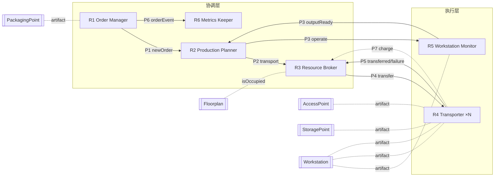
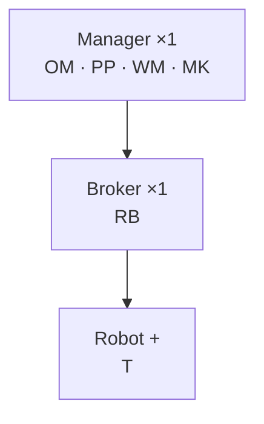

# M0 — GAIA 分析模型（Manufacturing Mayhem）

> **阶段定位**：GAIA **分析阶段（analysis phase）** 的产出 = **角色模型（Roles Model）+ 交互模型（Interactions Model）+ 组织规则（Organisational Rules）**。
> 本文件即 **M0 交付物**；M1–M6 全部从这里推导。**M0 定稿前不写实现代码。**
> 配套：`SOP.md`、`overview.md`、`COMP40040-Project-ManufacturingMayhem-解读.md`。

---

## 0. 交付物与验收

**交付物**

| # | 产物 | 在哪 |
| --- | --- | --- |
| 1 | **角色表**（每角色：职责 / 权限 / 活动 / 协议） | §2 |
| 2 | **交互表**（协议：发起方 / 响应方 / 消息 / 结果） | §3 |
| 3 | **组织规则** | §4 |
| 4 | **角色 → ASTRA 计划** 可追溯映射 | §5 |

**验收标准（SOP 原文）**：能口头说明「**用户需求 → 角色 → 交互协议 → ASTRA 计划**」这条链的**每一跳**。
→ 见 §1（需求→角色）与 §5（角色→计划）。

> GAIA 术语提醒：GAIA 用 **liveness（活性，"好事终将发生"）** 与 **safety（安全性，"坏事永不发生"）** 描述职责；用 **protocol（协议）** 描述角色间交互，用 **activity（活动）** 描述角色私有动作。

---

## 1. 从需求到角色（Derivation：需求 → 角色）

| 需求 / 验收线（来自作业 + SOP） | 需要的能力 | 承担角色 |
| --- | --- | --- |
| 订单闭环：装载 → 到齐 → deliver → 换单（验收 4） | 跟踪订单、触发交付、换单 | **Order Manager** |
| 目标函数：每单耗时 + 总价值（验收 5） | 计时计价 | **Metrics Keeper** |
| 多层依赖：WS-A 产出作为 WS-B 输入（验收 3） | 展开依赖、生成任务 | **Production Planner** |
| ≥2 机器人并发搬运（验收 2） | 任务分配、并发 | **Resource Broker** + **Transporter** |
| 不因冲突死锁（验收 7） | 互斥、等待/绕行 | **Resource Broker** |
| 低电自动充电（验收 6） | 能量管理 | **Transporter**（+ Broker 协调充电点） |
| 不假设 zone/robot 数量（验收 1） | 动态发现角色、按池分派 | 所有角色（尤其 **Resource Broker**） |
| 设计可追溯（验收 8） | 角色 ↔ 计划映射 | 本文件 §5 |

> **结论**：需求自然切出 **6 个角色** —— OM、PP、RB、T(×N)、WM、MK。

---

## 2. 角色模型（Roles Model）

> 每个角色给 4 项 GAIA 属性：**职责（liveness/safety）· 权限 · 活动 · 协议**。

### R1 · Order Manager（OM，订单管理者）

| 属性 | 内容 |
| --- | --- |
| **职责 (Liveness)** | ① 装入的每张订单**最终被结清**：$\text{LOADED}(o) \Rightarrow \Diamond\,\text{CLEARED}(o)$；② 结清后**最终装入下一张**：$\text{CLEARED}(o) \Rightarrow \Diamond\,\text{LOADED}(o')$；③ 每单的 start / fulfil 时间**最终被记录** |
| **职责 (Safety)** | ④ 订单在 **FULFILLED 之前**不得被修改；⑤ `outstanding` 非空时**不得** deliver |
| **权限 (Permissions)** | 读 `PackagingPoint.order` / `outstanding`；调用 `PackagingPoint.setOrder`（仅换单）与 `PackagingPoint.deliver`；调用 `Metrics.orderStarted/orderFulfilled` |
| **活动 (Activities)** | 监控 `outstanding` 变空 → 触发 deliver；请求 Product List 生成新订单；把事件交给 MK |
| **协议 (Protocols)** | `P1 Order-Intake`（→ PP）、`P6 Metrics-Record`（→ MK）；deliver 为**工件操作**（非 agent 消息） |

### R2 · Production Planner（PP，生产规划者）

| 属性 | 内容 |
| --- | --- |
| **职责 (Liveness)** | ① 对每个 `outstanding` 零件，**最终产生**「已取料」或「已生产」的执行方案；② 多层依赖**最终被展开**为可执行任务 DAG（有向无环图）；③ 任务**最终被派发** |
| **职责 (Safety)** | ④ 不得请求**未 ready** 的工作站开工；⑤ 不得违反配方（recipe）；⑥ 不得请求**不存在 / 库存为 0** 的物料 |
| **权限 (Permissions)** | 读 `Workstation.inputsNeeded/state/output`、`Warehouse` 库存、`AccessPoint.available`、`Product List`；**只读**，不直接动机器人 |
| **活动 (Activities)** | **递归展开 `inputsNeeded`**（多层依赖）；生成三类任务（取料 / 搬运 / 生产）；任务排序（先解锁下游） |
| **协议 (Protocols)** | `P1 Order-Intake`（收 OM）、`P2 Task-Dispatch`（→ RB）、`P3 Work-Order`（↔ WM） |

### R3 · Resource Broker（RB，资源代理）

| 属性 | 内容 |
| --- | --- |
| **职责 (Liveness)** | ① 每个待处理搬运**最终被授予**某机器人，或**最终失败并上报**；② zone 释放后**最终唤醒**等待者；③ 冲突时**最终重试成功** |
| **职责 (Safety)** | ④ **同一 zone 不得同时授予两个机器人**（互斥）；⑤ **同一机器人不得同时承接两个搬运**；⑥ 不得把任务授予**能量不足**的机器人（除非先安排充电） |
| **权限 (Permissions)** | 读 `Floorplan.locations/isOccupied`、`Robot.state/energy/at/holding`；写「分配表」（内部信念） |
| **活动 (Activities)** | 匹配（task ↔ 空闲 robot）；冲突解决（等待 / 换序）；**死锁避免**（打破循环等待）；充电点协调 |
| **协议 (Protocols)** | `P2 Task-Dispatch`（收 PP）、`P4 Transport-Assign`（→ T）、`P5 Transport-Result`（收 T） |

### R4 · Transporter（T，搬运者）— ×N（每个机器人一个）

| 属性 | 内容 |
| --- | --- |
| **职责 (Liveness)** | ① 每个被分配的搬运**最终回报** `transferred` 或 `failed`；② 电量低于阈值时**最终**回到充电点并**完成充电** |
| **职责 (Safety)** | ③ **一次只搬 1 件**；④ **不进入被占 zone**；⑤ 不在未装载时 unload、不超载 |
| **权限 (Permissions)** | `Robot` 工件：`move` / `load` / `unload` / `charge`；读自身 `state/at/holding/energy`；间接触发 `AccessPoint.take`、`StoragePoint.take/give`、`Workstation.take/give`、`PackagingPoint.give` |
| **活动 (Activities)** | `move` / `load` / `unload` / `charge` |
| **协议 (Protocols)** | `P4 Transport-Assign`（收 RB）、`P5 Transport-Result`（回 RB）、`P7 Charge`（自触发 / 向 RB 申请充电点） |

### R5 · Workstation Monitor（WM，工作站监视者）— ×N 或集中式

| 属性 | 内容 |
| --- | --- |
| **职责 (Liveness)** | ① 工作站 READY 时**最终被 operate**；② DONE 时**产出最终被取走** |
| **职责 (Safety)** | ③ **不得 operate 非 ready 的工作站**；④ 不得丢失产出 |
| **权限 (Permissions)** | 读 `Workstation.state/inputsNeeded/output`；调用 `Workstation.operate` |
| **活动 (Activities)** | 监视状态；触发 operate；报告产出就绪 |
| **协议 (Protocols)** | `P3 Work-Order`（收 PP 的 operate 请求 / 回 `outputReady`） |

### R6 · Metrics Keeper（MK，度量记录者）

| 属性 | 内容 |
| --- | --- |
| **职责 (Liveness)** | ① 每个订单事件**最终被记录**；② `totalTime` / `totalValue` / `ordersDone` **最终正确** |
| **职责 (Safety)** | ③ **不重复计数**；④ 累计值**单调不减** |
| **权限 (Permissions)** | 读/写 `Metrics` 工件 |
| **活动 (Activities)** | 记录 start / fulfil 时间与价值；累计 |
| **协议 (Protocols)** | `P6 Metrics-Record`（收 OM） |

---

## 3. 交互模型（Interactions Model）

### 3.1 协议表（Protocols）

| ID | 协议 | 发起方 | 响应方 | 触发 | 消息（请求 → 回复） | 成功结果 | 失败结果 |
| --- | --- | --- | --- | --- | --- | --- | --- |
| **P1** | Order-Intake | OM | PP | 订单装入 | `request(newOrder, items)` → `inform(accepted)` | PP 生成任务 | PP 拒收（物料不存在） |
| **P2** | Task-Dispatch | PP | RB | 有待搬运任务 | `request(transport, from, to, item)` → `inform(granted)\|inform(denied)` | 任务进入分配 | 无可用机器人 → 重试 |
| **P3** | Work-Order | PP | WM | 某 WS 输入将齐 / 收到 outputReady | `request(operate, ws)` ↔ `inform(outputReady, ws, item)` | WS 产出成品 | WS 未 ready → 等待 |
| **P4** | Transport-Assign（**Contract Net**，见 §9.2） | RB | T（全部可用 Robot） | 有任务 + 有可用机器人 | `cfp(transport)` → `propose(cost)\|refuse` → `accept-proposal\|reject-proposal` | 中标机器人执行搬运 | 全员 refuse / 超时无标 → 任务回队列重发 |
| **P5** | Transport-Result | T | RB（转 PP） | 搬运结束 | `inform(transferred, from, to)` / `inform(failure, reason)` | PP 更新任务状态 | PP 重派任务 |
| **P6** | Metrics-Record | OM | MK | 订单开始 / 完成 | `inform(orderStarted, id)` / `inform(orderFulfilled, id, value)`（时间由 `Metrics` 工件自取） | 计入统计 | — |
| **P7** | Charge-Notify | T | RB | 电量 < 阈值 | `inform(charging)` → …充电… → `inform(charged)` | RB 在充电期间不向其发 cfp | —（充电点为机器人专属，无争抢） |

> **对照现有代码**：当前只有 `P4/P5` 的雏形——`Main` 用 `send(request, robot, transfer(from,to))` + `wait(transferred(from,to))`（见 `Main.astra` `+!transfer`），`Robot.astra` 用 `@message(request,...,transfer(from,to))` 接收、`send(inform, sender, transferred(from,to))` 回复。**P1、P2、P3、P5-failure、P6、P7 都是新增。**

### 3.2 消息词汇表（Message Vocabulary）

> 参照 `Base.astra` 的 `types comms { transfer, transferred }` 扩展。

| 消息公式 | 方向 | 含义 |
| --- | --- | --- |
| `newOrder(list items)` | OM → PP | 新订单所需零件清单 |
| `transport(string from, string to, string item)` | PP → RB | 请求把 item 从 from 搬到 to |
| `transfer(string from, string to)` | RB → T | 指派一次搬运（现有） |
| `transferred(string from, string to)` | T → RB/PP | 完成回执（现有） |
| `failure(string reason)` | T → RB/PP | 失败回执（**新增，防死锁**） |
| `operate(string ws)` | PP → WM | 请求运行工作站 |
| `outputReady(string ws, string item)` | WM → PP | 产出就绪 |
| `orderStarted(string id)` / `orderFulfilled(string id, int value)` | OM → MK | 订单事件；时间戳由 `Metrics` 用 `System.currentTimeMillis()` 统一取，保证单一时钟 |

### 3.3 交互总览图



---

## 4. 组织规则（Organisational Rules）

### 4.1 角色关系（Relationships）

| 关系 | 从 | 到 | 说明 |
| --- | --- | --- | --- |
| **Authority（权威）** | PP | RB, WM | PP 定任务，RB/WM 执行 |
| **Authority（权威）** | RB | T | RB 分配，T 执行 |
| **Peer（对等）** | OM ↔ PP | — | 订单与生产的协商 |
| **Peer（对等）** | OM ↔ MK | — | 事件上报 |
| **Acquaintance（认识）** | 全角色 | Floorplan（artifact） | 通过环境共享状态 |

### 4.2 结构规则（Structural）

1. **每张订单恰好由 1 个 Order Manager 管理**（1 PackagingPoint ↔ 1 OM 实例）。
2. **每个工作站恰好由 1 个 Workstation Monitor 监视**（可集中为 1 个 agent 扮演多个 WM 角色）。
3. **每个机器人恰好由 1 个 Transporter 扮演**（机器人数 = Transporter 数，**不写死 N**）。
4. **所有搬运必须经 RB 分配**——Transporter **不得**被 PP 直接指派（强制单一分配权，防冲突）。
5. **zone 互斥的最终权威是 `Floorplan`**（代码已实现 `isOccupied` + `move` 抛异常）；RB 是**上层调度**，Floorplan 是**底层兜底**。

### 4.3 行为规则（Behavioural / Safety）

6. **一个 zone 同时至多 1 个机器人**（安全属性，Floorplan 强制）。
7. **一个机器人同一时刻至多 1 个搬运任务**（RB 强制）。
8. **订单未 FULFILLED 不得 CLEARED**；未 CLEARED 不得装新单（OM 强制）。
9. **任何失败必须回执** `failure`，否则会重演当前代码的 `Main` 永久 `wait` 死锁（`Robot.astra` 目前无失败回执）。

---

## 5. 角色 → ASTRA 计划 映射（Traceability）

> **验收 8 的核心**：每个 role / interaction 都能指到具体计划。

| 角色 | 现有可复用计划（`Base.astra` / `Main.astra` / `Robot.astra`） | 需新增计划 | 目标文件 |
| --- | --- | --- | --- |
| **OM** | `!order`、`!packagingPoint`、`?available`(pp) | `!orderLoop`、`!deliver`、`?outstanding`、`!loadNextOrder` | `Manager.astra` 订单计划组 |
| **PP** | `?inputsNeeded`、`?state`、`!configure`、`!available`(ap)、`!operate` | `!expandDependencies`、`!planTasks`、`!dispatch` | `Manager.astra` 编排计划组 |
| **RB** | `?locations`、`?free`（`isOccupied`） | `!allocate`（发 cfp + 收标 + 授标）、`!trackRobot`、`?availableRobots` | `Broker.astra`（新） |
| **T** | `!at`、`!holding`、`!empty`、`@message(request,...,transfer)` 骨架 | `@message(cfp)` 投标、`@message(accept-proposal)` 执行、`failure` 回执、阈值充电 + P7 通知 | `Robot.astra` |
| **WM** | `?state`、`!operate` | 监视循环、`outputReady` 上报 | `Manager.astra` 监视计划组 |
| **MK** | — | 依赖 `Metrics` 工件 | 新 `Metrics.java` + `Manager.astra` 查询计划 |

**「需求 → 角色 → 协议 → 计划」一跳示例**（把这条链讲清楚即可过验收）：

```text
需求：多层依赖（验收 3）
  └─ 角色：Production Planner(R2)
       └─ 协议：P2 Task-Dispatch / P3 Work-Order
            └─ 计划：!expandDependencies (Main.astra)
                     → request(transport,...) → Broker
                     → !operate (Base.astra, 已有)
```

---

## 6. 与现有代码的差距（喂给 M1）

> M0 已把「需要什么能力」定清；下列是**角色能落地的前提**，与 SOP M1 一一对应。

| 角色需求 | 代码缺口 | 对应 SOP 任务 |
| --- | --- | --- |
| RB 要按角色查 zone（不写死 `ap1`） | `Floorplan` 无「按类型列 zone」 | **M1-1** `zonesOfType(...)` |
| OM 要结单 + 换单 | `PackagingPoint.deliver()` 是打印桩、`setOrder` 只能调一次 | **M1-2** |
| MK 要计时计价 | 无 `Metrics` 工件 | **M1-3** `Metrics.java` |
| T 要正确的能量与拒绝逻辑 | `load/unload` 误用 `MOVE_COST`、`charge` 不封顶、`retrieve` 可覆盖 | **M1-4** |

---

## 8. 验收自检（对照 SOP 8 条）

| SOP 验收 | 本模型如何保证 |
| --- | --- |
| 1 不假设数量 | RB 用 `?locations` + `zonesOfType` 动态发现；机器人数 = Transporter 数 |
| 2 ≥2 机器人并发 | P2/P4/P5 异步派发；Broker 以 CNP 向所有可用 Robot 并行发标（§9.2） |
| 3 多层依赖 | PP 的 `!expandDependencies` 递归展开 `inputsNeeded` |
| 4 订单闭环 | OM 的 `!orderLoop` + `!deliver` + `!loadNextOrder` |
| 5 目标函数可读 | MK 的 `Metrics`（totalTime/totalValue/ordersDone） |
| 6 低电自动充电 | Robot 的 Recharge service（阈值触发）+ P7 Charge-Notify 通知 Broker |
| 7 不死锁 | Manager 只派可执行任务 + `Floorplan` 底层互斥 + P5 `failure` 回执重派（§9.3 冲突策略） |
| 8 设计可追溯 | §5 角色→计划映射表 |

---

## 9. 设计阶段（Design Phase）

> GAIA **design phase** 产出 = **Agent Model + Services Model + Acquaintance Model**，全部由 §2 角色、§3 协议推导。
> 已确认决策（2026-11-03）：① 3 类 agent；② 任务分配用 **Contract Net Protocol（CNP，合同网协议）**；③ P7 保留为协议（Charge-Notify）。

### 9.1 Agent Model（智能体模型）

| Agent type | 扮演 role | 实例数（GAIA 记法） | 理由 |
| --- | --- | --- | --- |
| `Manager` | OM + PP + WM + MK | **1** | 四者共享订单与任务 DAG 状态，合并避免状态同步 |
| `Broker` | RB | **1** | CNP 的 **manager（发标方）**，集中持有 zone / 机器人分配权（规则 4） |
| `Robot` | T | **+**（≥1，由 scenario 决定） | CNP 的 **contractor（投标方）**，运行时动态创建，不写死数量 |

> 记法：`1` = 恰好一个；`+` = 一个或多个。



### 9.2 P4 的 Contract Net 细化

```text
Broker ──cfp(transport(from,to,item))──▶ 所有可用 Robot（排除 busy / charging）
Robot  ──propose(cost) / refuse────────▶ Broker      （deadline 超时截止）
Broker ──accept-proposal──▶ 中标者；reject-proposal──▶ 其余投标者
中标者 ──inform(transferred) / failure──▶ Broker    （= P5）
```

**Bid（投标值）**：`Location` 无坐标、每次 `move` 固定耗能，故以**预估能耗**为标价：

$$cost = [\,at \neq from\,]\cdot 100 + 50 + 100 + 50$$

- **refuse（拒标）**：机器人 busy，或 $energy - cost < 100$（须留回家充电的电量）。
- **award（授标）**：$cost$ 最低者中标；平局取剩余 $energy$ 最高者。
- 效果：已停在 `from` 的机器人自然胜出（省一次 move）。

**新增消息词汇（补 §3.2）**

| 消息公式 | 方向 | performative |
| --- | --- | --- |
| `transport(string from, string to, string item)` | RB → T | `cfp` |
| `bid(int cost)` | T → RB | `propose` |
| `transport(...)` | T → RB | `refuse` |
| `award(string from, string to)` | RB → T | `accept-proposal` / `reject-proposal` |
| `charging()` / `charged()` | T → RB | `inform`（P7） |

### 9.3 Services Model（服务模型）

> 每个 service = 某 role 的一项功能，给出 **inputs / outputs / pre-condition / post-condition**。

| Agent | Role | Service | Inputs | Outputs | Pre-condition | Post-condition |
| --- | --- | --- | --- | --- | --- | --- |
| Manager | OM | **LoadOrder** | pp, product list | order | pp 为 CLEARED / 空 | pp LOADED；记录 `orderStarted` |
| Manager | OM | **DeliverOrder** | pp | value | `outstanding` 为空 | pp CLEARED；记录 `orderFulfilled`；触发 LoadOrder |
| Manager | PP | **ExpandDependencies** | order items, ws 配置 | task DAG | order 已 LOADED | DAG 每个 leaf 都是可在 AP 取得的 raw material |
| Manager | PP | **ConfigureWorkstation** | ws, product | — | ws IDLE 且未被占用 | ws 输出 product，`inputsNeeded` 已设 |
| Manager | PP | **RetrieveMaterial** | ap, item | — | ap 空闲（`available` = none） | item 置于 ap，待机器人 load |
| Manager | PP | **DispatchTask** | ready task | `transport(from,to,item)` → Broker | 源 item 已就位；目标可接收 | task 状态 = DISPATCHED |
| Manager | WM | **OperateWorkstation** | ws | — | ws READY | ws ACTIVE → DONE |
| Manager | WM | **ReportOutput** | ws | 新 transport task | ws DONE | 产出搬运任务进入 DAG |
| Manager | MK | **RecordEvent** | order id, t, value | totals | 事件未记录过 | `totalTime` / `totalValue` / `ordersDone` 单调不减 |
| Broker | RB | **AllocateTransport**（CNP manager） | transport task | award | ≥1 可用 Robot | 恰 1 个 Robot 中标；无人中标 → 回队列 |
| Broker | RB | **TrackRobot** | transferred / failure / charging / charged | 结果转发 Manager | 收到 P5 / P7 消息 | Robot 标记 idle / busy / charging |
| Robot | T | **Bid**（CNP contractor） | cfp | propose / refuse | Robot idle | 回复 cost 或 refuse |
| Robot | T | **ExecuteTransfer** | award(from,to) | transferred / failure | 中标且 holding = none | item 到达 to、holding = none；或已回执 failure |
| Robot | T | **Recharge** | — | charging / charged | energy < 阈值 | energy = max；已 inform Broker |

**Zone 冲突策略（已确认）**：两层防护，不做 zone reservation（预留）。

1. **预防**：DispatchTask 的 pre-condition 保证只派**可执行**任务（目标 ws 非 ACTIVE/DONE、目标 sp 空、源 item 已就位）。
2. **兜底**：`move` 遇 zone 被占（`Floorplan` 抛异常）→ Robot 短暂等待后重试；仍失败 → `failure` 回执 → Broker 转 Manager → 任务回队列重派（满足规则 9，不死锁）。

### 9.4 Acquaintance Model（熟人模型）

> 只表达**谁与谁存在通信路径**，不含消息细节。


| 通信对 | 方向 | 协议 |
| --- | --- | --- |
| Manager ↔ Broker | 双向 | P2（发任务）、P5（Broker 转发 transferred / failure） |
| Broker ↔ Robot | 双向 | P4（CNP）、P5（结果）、P7（charging / charged） |
| Manager ↔ Robot | **无** | 规则 4：所有搬运必须经 Broker |
| Robot ↔ Robot | **无** | 仅经 `Floorplan` artifact 间接协调 |

**说明**：P1 / P3 / P6 的两端（OM、PP、WM、MK）都由 `Manager` 扮演，在实现中退化为**同一 agent 内部的计划调用**，不产生消息——报告需明确说明此点。
结构为**两层 hierarchical + 单一 hub（Broker）**，通信路径最少，符合 GAIA 的 **low coupling（低耦合）** 原则。

### 9.5 Design 阶段检查

- [x] Agent Model：3 类 agent，实例数不写死（Robot `+`）
- [x] Services Model：14 个 service，均有 pre / post-condition
- [x] Acquaintance Model：2 条通信路径
- [x] 协调机制明确（CNP），并回写 §3.1 的 P4 / P7
- [x] §5 traceability 已对齐到 `Manager.astra` / `Broker.astra` / `Robot.astra`
