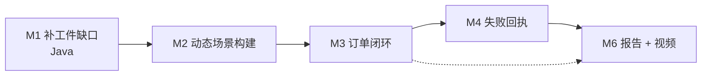

# SOP — Manufacturing Mayhem（最小可交路线）

> **2026-11-11 范围收缩**：只保留 `COMP40040_Project.docx` 明确要求的内容；已撤回 Broker/CNP、任务 DAG、库存预检拒收、Workstation 重新配置、价目表；第一版原始代码全部保留。

> 目标档位：**最小可交**（能验收、能讲清设计↔实现对应，不追求性能）
> 配套笔记：[overview.md](overview.md)（起点代码逐项核对）
> 起点代码：`manufacturing-mayhem/`（已加中文注释）

---

## 0. 验收线 —— 满足这几条就算「最小可交」

| # | 验收项 | 怎么证明 |
|---|---|---|
| 1 | **不假设数量**：zone / robot 数量变化，逻辑不变 | 把 `!setup` 里的 zone 与 robot 各翻倍，不加一行逻辑仍能跑通 |
| 3 | **多层依赖**：WS-A 的产出能作为 WS-B 的输入 | 跑一条 A→B 的两级产线并成功交付 |
| 4 | **订单闭环**：FULFILLED → `deliver` → CLEARED → 自动换新订单 | 连续完成 2 张订单 |
| 5 | **目标函数可读**：每单完成时间 + 总价值 | `Metrics` 工件能打印出 每单耗时 / 总完成时间 / 总价值 |
| 6 | **低电自动充电** | 电量低于阈值自动回 home 充电后续跑 |
| 7 | **不因冲突死锁** | 故意让两机器人抢同一 zone，系统能等待/绕行而非卡死 |
| 8 | **设计可追溯** | GAIA 文档里每个 role / interaction，能在代码里指出对应的 `.astra` 计划 |

> 第 **8** 条是真正的评分重心（占 40%），前 7 条是它的证据。

---

## 1. 现有资产（不重写）

| 资产 | 位置 | 状态 |
|---|---|---|
| 起点代码 917 有效行（ASTRA 270 + Java 647） | `manufacturing-mayhem/` | ✅ 可用 |
| `Base.astra` 计划库（创建 + 读属性的样板） | `src/main/astra/Base.astra` | ✅ 复用，**不要重写** |

**可以直接复用的东西**（省事重点）：

- 所有工件（`Floorplan` / `AccessPoint` / `Workstation` / `Robot` …）**已经在工作**，不需要从零造
- `Base.astra` 里的 `!floorplan / !accessPoint / !at / !holding / !empty / !operate` 等计划**都是现成的 API**，写编排逻辑时直接调用
- `?locations` 已经是动态发现场地的入口
- `PropertyExtractor` 已经解决「CArtAgO 属性 → ASTRA 列表/字符串」的转换

---

## 2. 写代码前必读的硬约束

| 约束 | 后果 |
|---|---|
| 每个 zone **恰好 1 个角色**，同时**只能 1 个 robot** | 所有调度必须先抢 zone，`Floorplan` 被占会抛异常；`Floorplan.move` 内部 `sleep(2000)`，同一 artifact 操作互斥 → 全场 move **可能被串行化**（见 §5 风险） |
| Access Point **取料后不可退回** | 取料时机必须想清楚，否则货卡在 ap 上 |
| 订单装入后**不可中途修改**，必须**显式 `deliver`** | 忘记 deliver → 订单永远不结清 |
| **不假设 agent / zone 数量** | 禁止出现 `ap1`、`r1` 这类硬编码 |
| `Workstation` 创建**无幂等保护**，重复建会抛异常；`configure` 用 `defineObsProperty`，**只能配置一次**（原始代码，未改） | 场景构建要判重；每个工作站只生产一种产品 |
| `duration` 参数是 `long`，必须写 `2000l` | 语法错 |
| `Warehouse` **不是 zone**，机器人进不去 | 取货只能经 Access Point |
| 一次移动实际耗时 **≈4 秒**（两层 `sleep 2000`） | 调度估算时别按 2 秒算 |

---

## 3. 任务清单与执行顺序

依赖关系（必须自下而上）：

---

### M1 — 补工件缺口（Java，让环境「可编排」）

**为什么第二步**：不补这几个缺口，M3/M4 只能靠硬编码绕过，后面必返工。

| # | 改什么 | 文件 | 具体动作 |
|---|---|---|---|
| M1-1 ✅ | 让 agent 能**按角色查 zone** | `Floorplan.java` | 已实现 `zonesOfType(String type, OpFeedbackParam<List<String>>)`；ASTRA 端 `cartago.operation(fpId, zonesOfType("AccessPoint", list aps))` 实测返回 `["ap2","ap1"]` → **Java `List<String>` 可直接回传为 ASTRA `list`**，无需 `pe.listValues`（结果顺序不固定） |
| M1-2 ✅ | 订单能**结清 + 换单** | `PackagingPoint.java` | 补状态属性（`loaded`/`fulfilled`/`cleared`）；`deliver()` 真正重置 `order`/`outstanding`；允许再次 `setOrder`（完整运行中连续换单 o1→o2→o3 通过） |
| M1-3 ✅ | 能**计时计价** | 新建 `artifacts/Metrics.java` | `orderStarted(id)` / `orderFulfilled(id, value)`，时间由工件自取；观察属性 `totalTime`、`totalValue`、`ordersDone`。**验收通过**：两单累计正确（516+302=818ms，10+5=15）；重复完成 / 未知订单 / 重复开始 / 负价值均被拒绝 |
| M1-4 🟡 | 修 3 个 bug | `Robot.java`、`AccessPoint.java` | `load`/`unload` 判电量误用 `MOVE_COST` → 改 `LOAD_COST`；`charge()` 加 `maxEnergy` 封顶；`retrieve` 在已持货时拒绝（已修，示例产线回归通过；异常分支待测） |
| ~~M1-5~~ ✂️ | ~~工作站能重复配置~~ | `Workstation.java` | **已撤回**：docx 未要求，`Workstation.java` 恢复为原始代码 |

验收：`mvn -o compile` 通过；写一个临时 `!main` 逐条调用新 API 并打印，全部有正确输出。

> **进度（2026-11-03）**：M1-1～M1-5 代码已完成并 push（commit `28a7e3a`）；编译通过，原示例产线回归跑通。
> **剩余专项测试**（一个临时测试 plan 一次跑完，通过后全部标 ✅）：
> 1. PackagingPoint：`deliver` 后 `status` 回 `cleared`，可再次 `setOrder`
> 2. Metrics：`orderStarted` → `orderFulfilled` 打印每单耗时 / 累计值；重复 fulfilled 抛异常
> 3. Robot：多次 `charge` 后 energy 不超过 `maxEnergy`
> 4. AccessPoint：有货时再 `retrieve` 被拒绝，且库存未被扣
> 5. Workstation：IDLE 且空闲时可重新 `configure`；持有输入件时被拒绝

---

### M2 — 动态场景构建（替掉全部硬编码）

| # | 做什么 |
|---|---|
| M2-1 ✅ | 场景改为**初始信念驱动**：`Main.astra` 顶部 `initial zone/robotSpec/stock/recipe/initialOrder`，`!setup` 用 `foreach` 遍历 + `+!createZone("ap"/"sp"/"pp"/"ws", name)` 按类型分派；回归跑通 |
| M2-2 ✅ | `Base.astra` 新增 `!discoverZones`：对 5 个角色调用 `zonesOfType`，存为 `zoneOf(角色, 名字)` 信念；`!main` 调用；实测 5 类 zone 共 7 个全部发现 |
| M2-3 ✅ | `foreach (robotSpec(name)) S.createAgent(name, "Robot")`；Robot.astra 用 `S.name()` 找回自身工件，无需改动；r1、r2 agent 均启动 |
| M2-4 ✅ | 示例流程改用 `?zoneOf(...)` / `?robot(...)` 取名，`while (state ~= "ready")` 按 `inputsNeeded` 取料；字面量只剩场景数据 `initial`；实测选中 ap2 仍跑通 |

验收：**验收项 1** —— zone 与 robot 各翻倍，不改逻辑仍跑通。

---

### M3 — 订单闭环

| # | 做什么 |
|---|---|
| M3-1 | 订单生命周期计划：装载 → 逐个零件确认到达 → `deliver` → 调 `Metrics` 记时间/价值 → 装下一张 |
| M3-2 ✅ | 订单所需零件 → 展开成需生产的中间品清单。**已实现于 `Base.astra`**：`!expand` 后序展开 → `buildStep(序号, ws, 产物)`（序号即生产顺序，原料不登记），`!produceItem` 按序号逐步 `!runStep`，中间品存 SP（`storedAt`），最终品直送 pp。完整运行通过：o3 `Delivered: [boxed-pie]`（112 秒） |
| M3-3 ✅ | 价值来源：**订单自带价值** `orderSpec(编号, 零件, 价值)`（Main 场景数据）。作业只要求 "Orders will have a value"，未规定来源；价目表方案已撤回。冒烟通过：o1 `value=10` |

验收：**验收项 4 + 5** —— 连续完成 2 张订单，`Metrics` 打印出每单耗时与累计价值。

####

### M4 — 失败回执（防死锁）

> docx 不要求并发 / CNP / 策略优化（性能 "mainly for fun"）。原 M4-1（任务 DAG）、M4-2（Broker + CNP）已实现后**撤回**；M4-3、M4-5、M4-6、整个 M5 删除。只保留防止系统永久卡死的失败回执。

| # | 做什么 |
|---|---|
| M4-4 ✅ | **失败回执**：`Robot.astra` 的 `@message(request, transfer)` 用 `try { ... } recover { send(failure, sender, transfer(from, to)) }`；`Main.astra` 加 `@message(failure, string sender, transfer(string from, string to))`，加 `+failed(from, to)` 信念；`!transfer` 把 `wait(transferred(from, to))` 改为等 `transferred | failed`，失败时打印并让当前订单失败而不是永久等待（规则 9） |

验收：**验收项 7** —— 机器人搬运失败时 Main 不卡死。

---

### M6 — 报告 + 视频

| # | 做什么 |
|---|---|
| M6-1 | 报告：**反思挑战与经验教训**（不是罗列功能），突出设计决策为什么这么定 |
| M6-2 | 把 [M0-GAIA-分析模型.md](M0-GAIA-分析模型.md) §2–§9 的 GAIA 模型整理成**英文**放进报告，**每条设计指到具体计划名/行号** |
| M6-3 | 3–5 分钟视频：镜头对准「设计文档 → 代码 → 运行画面」的对应，不追求大片效果 |

---

## 4. 当前进度

| 阶段 | 类型 | 语言 / 文件 | 要做什么 | 状态 |
|---|---|---|---|---|
| **M1** 补工件缺口 | coding | **Java**（CArtAgO artifact） | `Floorplan.zonesOfType`、`PackagingPoint.deliver` 结单换单、新建 `Metrics.java`、修 3 个 bug、`configure` 可重复（M1-5） | ✅ 由 M2–M4 运行覆盖验证（zonesOfType、deliver、Metrics） |
| **M2** 动态场景 | coding | **ASTRA** | 去掉 35 处硬编码 `ap1` / `r1`，改成列表循环创建 | ✅ 完成（M2-1～M2-4） |
| **M3** 订单闭环 | coding | ASTRA | LoadOrder → DeliverOrder → 换单；多层依赖；订单价值 | ✅ 完整运行通过：o1+o2+o3，ordersDone=3，totalValue=50，225 秒 |
| **M4** 失败回执 | coding | `Robot.astra`、`Main.astra` | `failure` 回执，防永久等待 | ✅ 冒烟通过（故障注入 + o1 回归） |
| **M6** 报告 + 视频 | 非 coding | — | 英文 report、3–5 分钟视频 | ⬜ |

> **提醒**
> 1. Design 不是一次性的：coding 中若发现设计走不通，**回头改 [M0-GAIA-分析模型.md](M0-GAIA-分析模型.md) §9**，保持 design ↔ implementation 一致。
> 2. 最终 report 需**英文**，M6 时把 M0 文档里的 GAIA 模型整理成英文版。

---

## 5. 主要风险

| 风险 | 应对 |
|---|---|
| **设计 ↔ 实现漂移** → 代码偏离 §9 设计，丢 40% | 每改一处协议 / 计划，同步更新 [M0-GAIA-分析模型.md](M0-GAIA-分析模型.md) §5 与 §9 |
| 一次移动≈4 秒，调试周期长 | 临时把 `Thread.sleep` 调小（如 200ms）加速调试，交付前改回 |
| `Main` 单点卡死 | M4-4 的 `failure` 回执是硬要求，不是加分项 |
| 设计文档写成功能清单 | GAIA 要写 **role / interaction / organisation rule**，不是"系统能做什么" |
