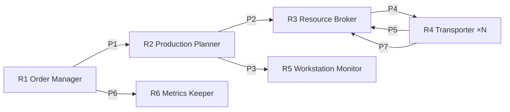
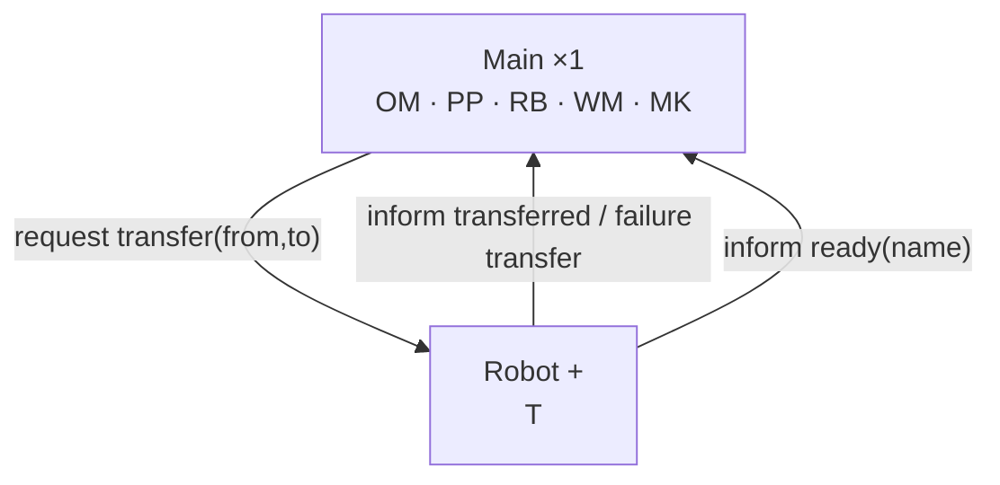

# Manufacturing Mayhem — GAIA Analysis and Design

COMP40040 Individual Project · Student 25208508

This document presents the GAIA models for the Manufacturing Mayhem system. The analysis models (§2–§4) describe the organisation in terms of roles, protocols and rules, independently of the platform. The design models (§5–§7) map that organisation onto concrete ASTRA agent types. §8 traces every service to the plan or CArtAgO operation that implements it. Line numbers refer to the submitted code.

Notation for liveness expressions: `x . y` means x followed by y; `x | y` means x or y; `x*` means zero or more times; `x+` means one or more times; `x^ω` means repeated indefinitely; `[x]` means x is optional; `x || y` means x and y are interleaved. Names in *italics* are **activities**, which a role performs on its own without interacting with others. The other names are **protocols**.

---

## 1. Requirements → roles

| Requirement from the brief | Capability needed | Role |
| --- | --- | --- |
| Orders are loaded, fulfilled, delivered, cleared and replaced | Track the order lifecycle | **Order Manager (OM)** |
| Orders have a value; the time to fulfil each one is recorded | Timing and value accounting | **Metrics Keeper (MK)** |
| Some inputs must be made at other workstations | Resolve multi-level dependencies into steps | **Production Planner (PP)** |
| Robots move parts; one robot per zone; the system must not stall | Allocate transfers, handle conflicts and failure | **Resource Broker (RB)** |
| Robots carry one item and have limited batteries | Execute transfers, recharge | **Transporter (T)** |
| Workstation lifecycle IDLE → READY → ACTIVE → DONE | Operate workstations when ready | **Workstation Monitor (WM)** |
| Do not assume the exact number of agents or zones | Discover zones and robots at runtime | All roles |

---

## 2. Roles Model

### R1 Order Manager (OM)

| Attribute | Content |
| --- | --- |
| **Liveness** | `OrderManager = (LoadOrder . RecordStart . (OrderProduction . AwaitFulfilled . DeliverOrder . RecordFulfilled | *AbandonOrder*))^ω` |
| **Safety** | An order is never changed before it is fulfilled. `deliver` is never called while `outstanding` is non-empty. A new order is never loaded until the previous one is cleared. |
| **Permissions** | reads `PackagingPoint.status`, `order`, `outstanding`; changes the `PackagingPoint` state via `setOrder` and `deliver`; generates `Metrics` events |
| **Activities** | *AwaitFulfilled*, *AbandonOrder* |
| **Protocols** | LoadOrder, DeliverOrder (artifact operations), OrderProduction (P1), RecordStart / RecordFulfilled (P6) |

### R2 Production Planner (PP)

| Attribute | Content |
| --- | --- |
| **Liveness** | `ProductionPlanner = (OrderProduction . *ExpandDependencies* . (RetrieveMaterial . TransportRequest | WorkOrder | *StoreIntermediate*)+)^ω` |
| **Safety** | Never ask a workstation to operate unless it is `ready`. Never produce an item that has no recipe and is not in stock. Never place two intermediate items in the same Storage Point. |
| **Permissions** | reads `Workstation.state` and `inputsNeeded`, scenario recipes and stock; changes `AccessPoint` (`retrieve`); does **not** command robots directly |
| **Activities** | *ExpandDependencies* (post-order expansion of recipes into numbered steps), *StoreIntermediate* (choose a free Storage Point) |
| **Protocols** | OrderProduction (P1), TransportRequest (P2), WorkOrder (P3), RetrieveMaterial (artifact operation) |

### R3 Resource Broker (RB)

| Attribute | Content |
| --- | --- |
| **Liveness** | `ResourceBroker = (TransportRequest . *SelectIdleRobot* . TransportAssign . TransportResult)^ω || (RobotReady)^ω` |
| **Safety** | A robot is never given a second transfer while it is busy or charging. A transfer is only assigned to a robot that has reported `ready` (and is therefore fully charged). Every assignment ends in either success or a reported failure. |
| **Permissions** | reads robot availability (`idle` beliefs); assigns transfers |
| **Activities** | *SelectIdleRobot* (wait and retry if no robot is idle) |
| **Protocols** | TransportRequest (P2), TransportAssign (P4), TransportResult (P5), RobotReady (P7) |

### R4 Transporter (T), one per robot

| Attribute | Content |
| --- | --- |
| **Liveness** | `Transporter = (TransportAssign . *MoveTo* . *Load* . *MoveTo* . *Unload* . TransportResult . *Recharge* . RobotReady)^ω`. On any failure: `TransportAssign . ... . TransportResult(failure)` |
| **Safety** | Carry at most one item. Never enter an occupied zone: wait until it is free. Never unload while not holding an item. |
| **Permissions** | changes its own `Robot` artifact (`move`, `load`, `unload`, `charge`); reads its own `at`, `holding`, `energy`, `maxEnergy`; reads `Floorplan.isOccupied` |
| **Activities** | *MoveTo*, *Load*, *Unload*, *Recharge* |
| **Protocols** | TransportAssign (P4), TransportResult (P5), RobotReady (P7) |

### R5 Workstation Monitor (WM)

| Attribute | Content |
| --- | --- |
| **Liveness** | `WorkstationMonitor = (WorkOrder . *CheckReady* . *Operate*)^ω` |
| **Safety** | Never operate a workstation that is not `ready`. Never lose an output: every output is moved to a Storage Point or to the Packaging Point. |
| **Permissions** | reads `Workstation.state`, `inputsNeeded`; changes the `Workstation` (`operate`) |
| **Activities** | *CheckReady*, *Operate* |
| **Protocols** | WorkOrder (P3) |

### R6 Metrics Keeper (MK)

| Attribute | Content |
| --- | --- |
| **Liveness** | `MetricsKeeper = (RecordStart | RecordFulfilled)^ω` |
| **Safety** | An order is never counted twice. Unknown orders and negative values are rejected. `totalTime`, `totalValue` and `ordersDone` never decrease. |
| **Permissions** | changes the `Metrics` artifact |
| **Activities** | — |
| **Protocols** | RecordStart / RecordFulfilled (P6) |

---

## 3. Interactions Model

| ID | Protocol | Purpose | Initiator | Responder | Inputs | Outputs | Processing |
| --- | --- | --- | --- | --- | --- | --- | --- |
| P1 | OrderProduction | Have every item of a loaded order produced | OM | PP | order id, item list, packaging point | items delivered to the packaging point, or failure | PP expands each item and executes its steps |
| P2 | TransportRequest | Ask for one item to be moved | PP | RB | from-zone, to-zone | transfer completed, or failure | RB selects an idle robot (P4) and waits for the result (P5) |
| P3 | WorkOrder | Run a workstation once its inputs are present | PP | WM | workstation | workstation `done` | WM checks `ready`, then operates |
| P4 | TransportAssign | Give a transfer to a specific robot | RB | T | `request transfer(from, to)` | — | T performs move / load / move / unload |
| P5 | TransportResult | Report the outcome of a transfer | T | RB | — | `inform transferred(from, to)` **or** `failure transfer(from, to)` | On failure, RB fails the requesting goal instead of waiting forever |
| P6 | RecordStart / RecordFulfilled | Account for time and value | OM | MK | `orderStarted(id)`, `orderFulfilled(id, value)` | updated totals | MK timestamps events with one clock |
| P7 | RobotReady | Tell the broker a robot is charged and available | T | RB | — | `inform ready(robot)` | RB adds the robot back to its idle pool |

Interaction overview:



---

## 4. Organisational Rules

**Structural rules**

1. Each Packaging Point is managed by exactly one Order Manager.
2. Each robot is played by exactly one Transporter. The number of Transporters equals the number of robots in the scenario and is not fixed in code.
3. Every transfer is assigned through the Resource Broker. A Production Planner never commands a robot directly, so there is a single point of allocation.
4. The final authority on zone exclusivity is the `Floorplan` artifact (`move` throws if the target is occupied). Transporters wait for a zone to become free, and the artifact is the safety net.

**Behavioural (safety) rules**

5. At most one robot occupies a zone at any time.
6. A robot holds at most one transfer at a time (it is removed from the idle pool when assigned).
7. An order is not cleared until it is fulfilled, and a new order is not loaded until the previous one is cleared.
8. **Every request receives a reply on every path.** A Transporter answers each `TransportAssign` with `transferred` or `failure`; otherwise the requester would wait forever (deadlock).

---

## 5. Agent Model

The six roles are grouped into two agent types. The main design decision is **centralised allocation**: one coordinator owns the order, the production plan and the allocation state, because these share most of their data. Robots are kept as separate agents because their number varies between scenarios and they act in parallel.

| Agent type | Roles played | Instances | Justification |
| --- | --- | --- | --- |
| `Main` | OM, PP, RB, WM, MK | **1** | Order state, production plan and robot availability are tightly coupled; one coordinator avoids keeping copies consistent. |
| `Robot` | T | **+** (one or more, from the scenario's `robotSpec` beliefs) | Created at runtime with `S.createAgent`; the code makes no assumption about how many exist. |



**Design alternative considered and withdrawn.** An earlier design had a third agent type, `Broker`, which allocated transfers with the Contract Net Protocol: call for proposals, bids from robots, award to the lowest cost. It was implemented and then removed. Because every robot returns to its charger after each job, all bids had the same cost, so the auction added messages but never changed the decision. A dependency graph for concurrent steps, stock pre-checks and workstation reconfiguration were removed for the same reason: the brief does not require them.

---

## 6. Services Model

| Agent | Role | Service | Inputs | Outputs | Pre-condition | Post-condition |
| --- | --- | --- | --- | --- | --- | --- |
| Main | OM | LoadOrder | pp, items | order loaded | `status == cleared` | `status == loaded`; `orderStarted` recorded |
| Main | OM | DeliverOrder | pp | order cleared | `status == fulfilled` | `status == cleared`; `orderFulfilled` recorded; next order taken |
| Main | PP | ExpandDependencies | item | `buildStep(k, ws, item)` beliefs | item has a recipe or is in stock | steps numbered in a valid production order |
| Main | PP | RetrieveMaterial | access point, item | item at the access point | access point empty | item available for loading |
| Main | PP | Produce | pp, step k | product stored or delivered | inputs of step k already exist | product at a Storage Point (`storedAt`) or at pp |
| Main | RB | AssignTransport | from, to | transfer done | some robot is `idle` (otherwise retry) | robot removed from the idle pool; waits for the P5 result |
| Main | WM | OperateWorkstation | ws | output produced | `state == ready` | `state == done` |
| Main | MK | RecordEvent | id, value | updated totals | event not yet recorded | totals monotonically non-decreasing |
| Robot | T | ExecuteTransfer | from, to | item moved | not holding an item | item at `to`; `transferred` or `failure` sent |
| Robot | T | Recharge | — | full battery | transfer finished | `energy == maxEnergy`; `ready` sent |

---

## 7. Acquaintance Model

| Pair | Direction | Messages |
| --- | --- | --- |
| Main ↔ Robot | both ways | P4 `request transfer`; P5 `inform transferred` / `failure transfer`; P7 `inform ready` |
| Robot ↔ Robot | **none** | Robots coordinate only indirectly, through the `Floorplan` artifact (zone occupancy) |

Protocols P1, P2, P3 and P6 connect roles that are all played by `Main`. They are therefore implemented as **goal calls inside one agent** (P1–P3) or as **artifact operations** (P6), not as messages. The resulting structure is a **star**, with `Main` as the single hub.

---

## 8. Traceability: design → implementation

| Role | Service / protocol | Implementation | Location |
| --- | --- | --- | --- |
| OM | Order loop (P1 initiator) | `+!orderLoop(pp)` | `Main.astra:123`, end of queue `:144` |
| OM | LoadOrder | `+!order(name, order)` → `PackagingPoint.setOrder` | `Base.astra:166`, `PackagingPoint.java:41` |
| OM | DeliverOrder | `+?orderStatus` + `+!deliver` → `PackagingPoint.deliver` | `Base.astra:335`, `:344`, `PackagingPoint.java:50` |
| OM | AbandonOrder | `try … recover` inside `+!orderLoop` | `Main.astra:123` |
| PP | ExpandDependencies | `+!expand(item)` (recipe / stock / unknown → fail) | `Base.astra:410`, `:419`, `:422` |
| PP | Produce | `+!produceItem` (multi-level / raw) → `+!runStep` | `Base.astra:349`, `:361`, `:367` |
| PP | Supply inputs / StoreIntermediate | `+!supply` (from SP / from AP), `+!storeItem` | `Base.astra:388`, `:393`, `:399` |
| PP | RetrieveMaterial | `+!available` → `AccessPoint.retrieve` | `Base.astra:108` |
| RB | AssignTransport (P2 responder, P4 initiator) | `+!transfer(from, to)` picks `idle(r)` → `+!transfer(r, from, to)` | `Main.astra:61`, `:67`, `:78` |
| RB | TransportResult (P5) | `@message(inform, transferred)`, `@message(failure, transfer)` | `Main.astra:95`, `:90` |
| RB | RobotReady (P7) | `@message(inform, ready)` → `+idle(r)` | `Main.astra:73` |
| RB | Runtime discovery | `+!discoverZones` → `Floorplan.zonesOfType` | `Base.astra:314`, `Floorplan.java:93` |
| T | ExecuteTransfer (P4 responder, P5 initiator) | `@message(request, transfer)` with `try/recover` | `Robot.astra:19` |
| T | MoveTo (waits for a free zone) | `+!at` → `+!waitFree` → `Robot.move` | `Base.astra:222`, `:229` |
| T | Load / Unload | `+!holding`, `+!empty` | `Base.astra:239`, `:254` |
| T | Recharge + RobotReady (P7) | `+!recharge` | `Robot.astra:38` |
| WM | OperateWorkstation | `+?state`, `+?inputsNeeded`, `+!operate` | `Base.astra:287`, `:280`, `:297` |
| MK | RecordEvent (P6) | `Metrics.orderStarted`, `Metrics.orderFulfilled` | `Metrics.java:28`, `:35` |

**Example chain: requirement → role → protocol → plan**

```text
Requirement: some inputs are made at other workstations
  └─ Role: Production Planner (R2)
       └─ Protocols: P2 TransportRequest, P3 WorkOrder
            └─ Plans: !expand → !produceItem → !runStep           (Base.astra)
                      ├─ !supply / !storeItem → !transfer(from,to)  (P2 → RB, Main.astra)
                      │     └─ request transfer → Robot             (P4, Robot.astra)
                      └─ !operate                                   (P3, Base.astra)
```

---

## 9. Evaluation against the brief

| Brief requirement | How the design meets it | Evidence |
| --- | --- | --- |
| Coordinate robots, workstations and storage to fulfil orders | Roles R1–R6; star organisation | Full run: 3 of 3 orders delivered |
| Multi-level production | PP post-order expansion + Storage Points | `boxed-pie` (apple-pie → boxed-pie) delivered in 90 s |
| Explicit deliver; new order only after clearing | Safety rule 7; `PackagingPoint` state machine | `cleared → loaded → fulfilled → cleared` across three orders |
| Order value and time recorded | MK + `Metrics` artifact | `ordersDone=3`, `totalValue=50`, `totalTime≈176 s` |
| Limited battery, return to charger | T's *Recharge* after every job | No `Insufficient Energy` errors in the full run |
| One robot per zone | Rule 4/5: `Floorplan` exclusivity + `!waitFree` | No occupancy failures with two robots moving at the same time |
| No assumption about the number of agents | Robots created from the scenario; idle-pool allocation; zones discovered by type | r1 and r2 each performed 6 of 12 transfers |
| System must not hang | Rule 8; P5 `failure` | Fault-injection test: failure returned, no deadlock |
