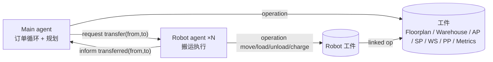

# 代码索引：函数与变量

> ASTRA 里没有"函数 / 变量"，对应关系是：
> - **plan（计划）** ≈ 函数。`+!x` 是"做某事"（goal），`+?x` 是"查询某值"（query），`@message` 是"收到消息时"。
> - **belief（信念）** ≈ 变量。由 `types { formula ... }` 声明类型，`initial` 给初值，`+x` 添加、`-x` 删除。
> - **artifact operation（工件操作）** = Java 方法，ASTRA 用 `cartago.operation(id, op(...))` 调用。

## 1. 文件分工

| 文件 | 角色 | 内容 |
|---|---|---|
| `Base.astra` | 公共计划库（父类） | 工件创建 / 查询、机器人动作、生产规划（依赖展开） |
| `Main.astra` | 入口 agent `main`（继承 Base） | 场景数据、建场景、订单循环 |
| `Robot.astra` | 机器人 agent `r1`、`r2`…（继承 Base） | 接收搬运请求、执行、充电、回执 |
| `artifacts/*.java` | CArtAgO 工件（环境） | 场地、仓库、各 zone、机器人工件、Metrics |



## 2. 信念（变量）

### 2.1 场景数据（`Main.astra` 的 `initial`，换场景只改这里）

| 信念 | 含义 | 被谁读 |
|---|---|---|
| `zone(类型, 名字)` | zone 定义，类型 `ap` / `sp` / `pp` / `ws` | `!setup` → `!createZone` |
| `robotSpec(名字)` | 机器人定义 | `!setup`（建工件）、`!main`（建 agent） |
| `stock(物料, 数量)` | 仓库库存 | `!setup`、`!expand`（判断是否原料） |
| `recipe(工作站, 输入, 产出, 耗时)` | 工作站配方 | `!setup`（configure）、`!expand`、`!produceItem` |
| `orderSpec(编号, 零件, 价值)` | 订单队列 | `!orderLoop`（取出即删除） |

> `stock`、`recipe` 的**类型**声明在 Base（Base 的规划 plan 要用），**数据**在 Main。

### 2.2 工件句柄（`Base` 的 `types main`，创建工件时写入）

| 信念 | 写入者 | 用途 |
|---|---|---|
| `floorplan(id)` | `!floorplan` | 几乎所有 zone 操作的 context |
| `warehouse(id)` | `!warehouse` | `!addToWarehouse`、AP 连接仓库 |
| `accessPoint(名字, id)` | `!accessPoint` | `!available`、`?available` |
| `storagePoint(名字, id)` | `!storagePoint` | `?available` |
| `packagingPoint(名字, id)` | `!packagingPoint` | `!order`、`?orderStatus`、`!deliver` |
| `workstation(名字, id)` | `!workstation` | `!configure`、`?state`、`?inputsNeeded`、`!operate` |
| `robot(名字, id)` | `!robot` | 机器人动作；`!produceItem` / `!runStep` 选机器人 |
| `chargePoint(名字, id)` | `!robot` | 记录充电点 |
| `metrics(id)` | `!metrics` | `!fulfil` 记账 |
| `zoneOf(角色, 名字)` | `!discoverZones` | 按角色选 zone（AP / SP / PP），**编排逻辑只用它，不用字面量** |
| `at(名字, 位置)` | `inference`（由机器人工件的 `at` 属性推导） | `!at` 判断是否已到位 |

### 2.3 生产规划（`Base` 的 `types planning`，每个订单零件重新生成）

| 信念 | 含义 | 写入 | 读取 |
|---|---|---|---|
| `seq(n)` | 序号计数器，初值 0；展开后即最后一步的序号 | `?nextSeq`、`!clearPlan` | `?nextSeq`、`!produceItem` |
| `buildStep(序号, ws, 产物)` | 一个生产步骤，**序号即生产顺序**（后序展开） | `!expand` | `!produceItem`、`!runStep` |
| `storedAt(中间品, sp)` | 中间品暂存位置 | `!storeItem` | `!supply`（取走即删除） |

### 2.4 消息内容（`types comms`）

| 消息 | 方向 | 含义 |
|---|---|---|
| `transfer(from, to)` | Main → Robot（`request`） | 请求搬运 |
| `transferred(from, to)` | Robot → Main（`inform`） | 搬运完成；Main 收到后也作为信念等待用 |
| `transfer(from, to)` | Robot → Main（`failure`） | 搬运失败回执（M4-4） |
| `failed(from, to)` | Main 信念（Base 声明） | 收到 failure 后加入，解除 `!transfer` 的等待 |

## 3. 计划（函数）

### 3.1 入口与订单（`Main.astra`，GAIA：Order Manager）

| 计划 | 功能 | 调用 |
|---|---|---|
| `+!main(args)` | 启动：建场景 → 建 Robot agent → 发现 zone → 建 Metrics → 每个 pp 跑订单循环 | `!setup`、`S.createAgent`、`!discoverZones`、`!metrics`、`!orderLoop` |
| `+!setup()` | 按场景信念创建所有工件 | `!warehouse`、`!addToWarehouse`、`!floorplan`、`!createZone`、`!robot`、`!configure` |
| `+!createZone("ap"/"sp"/"pp"/"ws", 名字)` | 按类型分派创建 zone | `!accessPoint` / `!storagePoint` / `!packagingPoint` / `!workstation` |
| `+!orderLoop(pp)` ① 有订单 | 出队一张单 → 装单 → 记开始 → 逐个零件生产 → 校验 fulfilled → 交付 → 记完成 → 递归下一张；中途失败则 `recover` 打印并清空队列 | `!order`、`orderStarted`、`!produceItem`、`?orderStatus`、`!deliver`、`orderFulfilled`、`!orderLoop` |
| `+!orderLoop(pp)` ② 无订单 | 打印 "all orders done" | — |
| `+!transfer(机器人, from, to)` | 发搬运请求并**阻塞等待**回执；收到 failed 则 `S.fail()` | `send(request)`、`wait(transferred \| failed)` |
| `@message(inform, transferred)` | 收到回执，加信念解除等待 | — |
| `@message(failure, transfer)` | 收到失败回执，`+failed` 解除等待 | — |

### 3.2 生产规划（`Base.astra`，GAIA：Production Planner + Workstation Monitor）

| 计划 | 功能 | 调用 / 读写 |
|---|---|---|
| `+!expand(物料)` ① 有配方 | 先递归展开各输入，再登记本步骤（后序 → 序号即生产顺序） | `?nextSeq`；写 `buildStep` |
| `+!expand(物料)` ② 有库存 | 原料，不登记（生产时从 AP 取） | — |
| `+!expand(物料)` ③ 都没有 | 打印 cannot make，`S.fail()` | — |
| `+?nextSeq(n)` | 取下一个编号 | 读写 `seq` |
| `+!clearPlan()` | 清空上一次的展开结果 | 删 `buildStep`；重置 `seq` |
| `+!produceItem(pp, 零件)` ① 需生产 | 展开依赖 → 按序号 1..last 逐步 `!runStep` | `!clearPlan`、`!expand`、`!runStep` |
| `+!produceItem(pp, 零件)` ② 原料 | 直接从 AP 取料送到 pp | `!available`、`!transfer` |
| `+!runStep(pp, k, last)` | 补齐 ws 输入 → `!operate` → 最后一步送 pp，否则存入 SP | `?state`、`?inputsNeeded`、`!supply`、`!operate`、`!transfer`、`!storeItem` |
| `+!supply(物料, ws, ap, 机器人)` ① 中间品 | 从存储点送到 ws | 读删 `storedAt`；`!transfer` |
| `+!supply(...)` ② 原料 | AP 取料后送到 ws | `!available`、`!transfer` |
| `+!storeItem(ws, 物料, 机器人)` | 送到空闲 SP 并记录位置；无空闲 SP 则失败 | `!transfer`；写 `storedAt` |

### 3.3 工件创建与查询（`Base.astra`）

| 计划 | 功能 | 工件操作 |
|---|---|---|
| `+!floorplan(id)` | 查找或创建 Floorplan | `lookupArtifact` / `makeArtifact` |
| `+?locations(列表)` | 所有 zone 名 | 读 `locations` 属性 |
| `+?free(zone)` | 空闲成功，被占失败 | `Floorplan.isOccupied` |
| `+!discoverZones()` | 对 5 种角色写入 `zoneOf` | `Floorplan.zonesOfType` |
| `+!warehouse(id)` / `+!addToWarehouse(物料, 数量)` | 创建仓库 / 加库存 | `Warehouse.add` |
| `+!accessPoint(名字, id)` | 创建 AP，连接仓库与 Floorplan | `install` |
| `+!available(ap, 物料)` | AP 从仓库取一件 | `AccessPoint.retrieve` |
| `+?available(ap 或 sp, 物料)` | AP / SP 上当前的物料 | 读 `available` 属性 |
| `+!storagePoint(名字, id)` | 创建存储点 | `install` |
| `+!packagingPoint(名字, id)` | 创建包装点 | `install` |
| `+!order(pp, 零件)` | 装入订单 | `PackagingPoint.setOrder` |
| `+?orderStatus(pp, 状态)` | 订单状态；传入值时做比较 | 读 `status` 属性 |
| `+!deliver(pp)` | 交付订单 | `PackagingPoint.deliver` |
| `+!workstation(名字, id)` / `+!configure(...)` | 创建 / 配置工作站 | `install`、`Workstation.configure` |
| `+?state(ws, 状态)` | 工作站状态；传入值时做比较 | 读 `state` 属性 |
| `+?inputsNeeded(ws, 列表)` | 工作站还缺的输入 | 读 `inputsNeeded` 属性 |
| `+!operate(ws)` | 运行并轮询直到 `done` | `Workstation.operate` |
| `+!metrics(id)` | 查找或创建 Metrics | `lookupArtifact` / `makeArtifact` |

### 3.4 机器人动作（`Base.astra`，由 Robot agent 调用）

| 计划 | 功能 | 工件操作 |
|---|---|---|
| `+!robot(名字, id)` | 查找或创建机器人工件 + `<名字>-charger` | `makeArtifact`、`RobotChargePoint.install` |
| `+?at` / `+?energy` / `+?maxEnergy` | 位置 / 电量 / 电量上限 | 读属性 |
| `+!at(名字, 位置)` ① 已到位 | 什么都不做 | — |
| `+!at(名字, 位置)` ② 未到位 | 目标空闲则移动 | `?free`、`Robot.move` |
| `+!holding(名字, 物料)` | 装货 | `Robot.load` |
| `+?holding(名字, 物料)` | 手上的货 | 读 `holding` 属性 |
| `+!empty(名字)` | 卸货 | `Robot.unload` |

### 3.5 Robot agent（`Robot.astra`，GAIA：Transporter）

| 计划 | 功能 | 调用 |
|---|---|---|
| `initial !init()` → `+!init()` | 连接工作区，查找自己的工件（`S.name()`），`focus` 以观察属性 | `!floorplan`、`!robot`、`cartago.focus` |
| `@message(request, transfer(from, to))` | 去 from 装货 → 去 to 卸货 → 回充电点循环充电至满 → 回执；任一步失败 `recover` 回 `failure` | `!at`、`!holding`、`!empty`、`?energy`、`?maxEnergy`、`Robot.charge`、`send(inform, transferred)` |

## 4. Java 工件操作

| 工件 | 操作 | 观察属性 |
|---|---|---|
| `Floorplan` | `install`、`location`、`move`、`place`、`isOccupied`、`zonesOfType`、界面更新 | `locations` |
| `Warehouse` | `add`、`retrieve` | 每种物料一个数量属性 |
| `AccessPoint` | `retrieve`（已有货则拒绝）、`take` | `available` |
| `StoragePoint` | `give`、`take` | `available` |
| `Workstation` | `configure`（仅 IDLE 且空）、`operate`、`give`、`take` | `state`、`inputs`、`output`、`inputsNeeded`、`duration` |
| `PackagingPoint` | `setOrder`（仅 cleared）、`give`、`deliver`（仅 fulfilled） | `status`、`order`、`outstanding` |
| `Robot` | `move`、`load`、`unload`、`charge`（封顶 maxEnergy） | `state`、`holding`、`at`、`energy`、`maxEnergy` |
| `RobotChargePoint` | `install`（同时创建 Robot 工件） | `available` |
| `Metrics` | `orderStarted(id)`、`orderFulfilled(id, value)` | `totalTime`、`totalValue`、`ordersDone` |

## 5. 关键调用链

### 5.1 一张订单的生命周期

```text
!main
 └─ !orderLoop(pp)                       取出 orderSpec
     ├─ !order(pp, items)                PackagingPoint: cleared → loaded
     ├─ Metrics.orderStarted(id)
     ├─ !produceItem(pp, item)           每个零件
     ├─ ?orderStatus(pp, "fulfilled")
     ├─ !deliver(pp)                     fulfilled → cleared
     ├─ Metrics.orderFulfilled(id, value)
     └─ !orderLoop(pp)                   下一张
```

### 5.2 一个零件的生产（以 `boxed-pie` 为例）

```text
!produceItem(pp, "boxed-pie")
 ├─ !expand("boxed-pie")
 │   ├─ !expand("apple-pie")
 │   │   ├─ apples、pastry → 原料，跳过
 │   │   └─ 登记 buildStep(1, ws1, apple-pie)
 │   ├─ box → 原料，跳过
 │   └─ 登记 buildStep(2, ws2, boxed-pie)        last = 2
 └─ k = 1..2
     ├─ k=1：!runStep → supply apples/pastry（AP）→ operate ws1 → !storeItem → storedAt(apple-pie, sp1)
     └─ k=2：!runStep → supply apple-pie（SP）+ box（AP）→ operate ws2 → !transfer(ws2 → pp)
```

### 5.3 一次搬运

```text
Main  !transfer(r, from, to) ── send(request, transfer) ──▶ Robot @message
                                                              !at(from) → Robot.move
                                                              !holding  → Robot.load   → 源工件.take
                                                              !at(to)   → Robot.move
                                                              !empty    → Robot.unload → 目标工件.give
                                                              回充电点，charge 至满
Main  wait(transferred | failed) ◀── send(inform, transferred) ┘
                                  ◀── send(failure, transfer)   （任一步失败）
```

## 6. 与 GAIA 角色的对应

| GAIA 角色 | 代码位置 |
|---|---|
| R1 Order Manager | `Main`：`!orderLoop`；`Base`：`!order`、`?orderStatus`、`!deliver` |
| R2 Production Planner | `Base`：`!expand`、`!produceItem`、`!runStep`、`!supply`、`!storeItem` |
| R3 Resource Broker | `Main` 的 `!transfer`（集中式分派）；`Base` 的 `!runStep` / `!produceItem` 用 `?robot` 选机器人 |
| R4 Transporter | `Robot.astra`：`@message(request, transfer)` |
| R5 Workstation Monitor | `Base`：`!runStep` 中的 `?state` / `!operate`（M4-6 改为事件驱动） |
| R6 Metrics Keeper | `Metrics.java`；`Main` 的 `!orderLoop` 调用 `orderStarted` / `orderFulfilled` |

## 7. 已知限制

- 只用一个机器人（`?robot` 取第一个），搬运同步阻塞（`wait`）；docx 不要求并发
- Robot 失败不回执，Main 会永久等待 → M4-4
